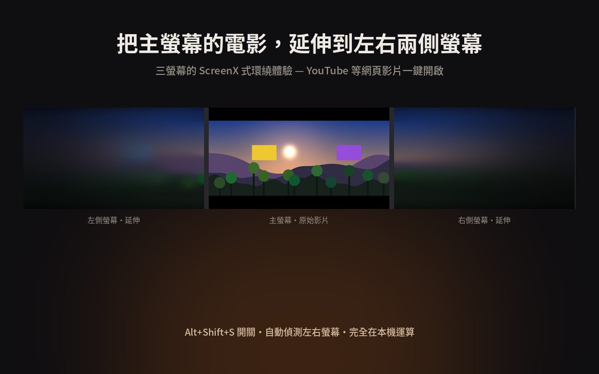
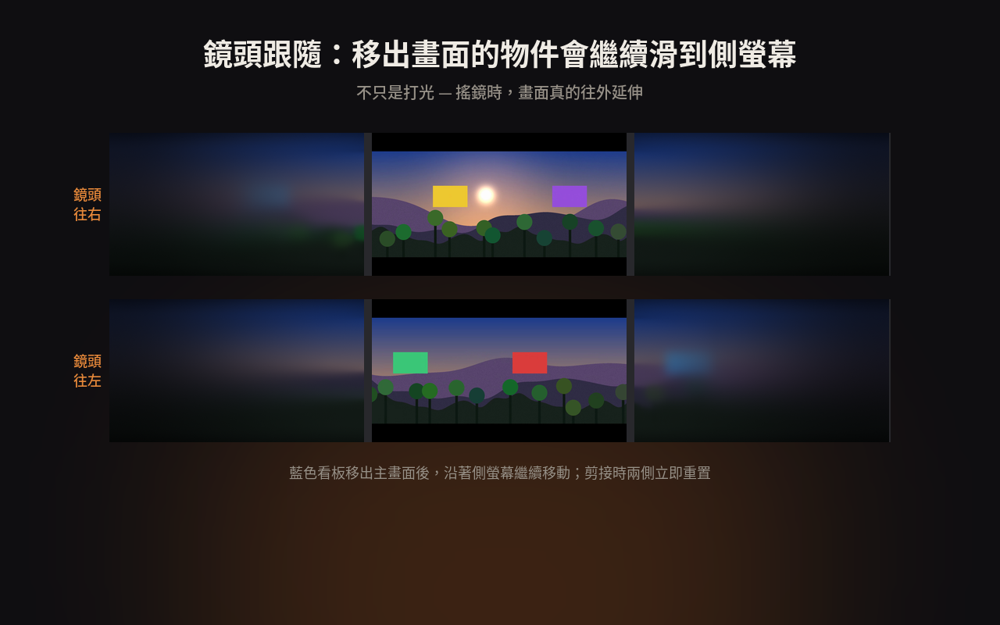
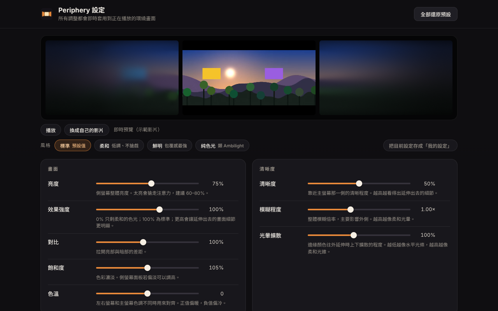

# Periphery 環繞延伸

> 把主螢幕正在播放的影片，即時延伸到左右兩側螢幕，在家打造 ScreenX 式的三螢幕環繞觀影。
>
> A Chrome extension that extends the video on your main monitor onto your left and right monitors in real time — a ScreenX-style wraparound cinema for three-monitor setups.



## 為什麼看起來不假

人的餘光本來就看不清細節，所以側螢幕不需要清楚的畫面。只要顏色、亮度和**動態**跟主畫面一致，大腦就會把它當成畫面的延伸。這個做法參考自 MIT Media Lab 的 [Infinity-by-Nine](https://www.media.mit.edu/projects/infinity-by-nine/overview/) 研究。



- **鏡頭跟隨**：估算每一格畫面的鏡頭移動。搖鏡時，移出主畫面的內容會繼續滑到側螢幕上。
- **光錐延伸**：邊緣顏色往外延伸時會逐漸上下擴散，不會變成生硬的橫條。
- **自動去黑邊**：寬銀幕電影也會從真正的畫面邊緣取色。
- **場景切換偵測**：剪接時兩側立即重置。
- **漸進模糊、漸暗、去色帶**：符合人眼周邊視覺的特性，大面積漸層也不會出現色階。
- 全部在 GPU（WebGL2）上即時運算，不收集也不傳送任何資料。

## 安裝

### 從 Release 安裝（推薦）
1. 到 [Releases](../../releases) 下載最新的 `periphery-x.y.z.zip`，解壓縮到一個固定的資料夾。
2. 打開 `chrome://extensions`，開啟右上角的「開發人員模式」。
3. 按「載入未封裝項目」，選擇解壓縮出來的資料夾，也就是裡面有 `manifest.json` 的那一層。

### 從原始碼安裝
直接 clone 這個 repo，「載入未封裝項目」時選擇 `extension/` 資料夾。

## 使用

1. 在 YouTube 或其他影片網站上播放影片。
2. 按 **Alt+Shift+S**，或點工具列圖示再按「開啟環繞模式」。
3. 把影片切到全螢幕。
4. 要關閉時，再按一次 **Alt+Shift+S**，或在側螢幕上按 **Esc**。

本機影片檔請用工具列選單裡的「本機播放器」播放。詳細說明和常見問題請見 [使用說明](docs/USER_GUIDE.md)。



設定頁有 21 項細節調整、四種風格和三螢幕即時預覽。每一項都能單獨還原，也能一鍵全部還原。

## 限制

- Netflix、Disney+ 等使用 **DRM** 的平台，瀏覽器不允許任何外掛讀取畫面，所以無法使用。
- 作業系統的顯示器排列需要和實際擺放位置一致，外掛才能正確判斷左右螢幕。偵測錯誤時，可以在設定頁手動指定。

## 專案結構

```
extension/        外掛本體（Manifest V3，無任何建置步驟、無外部相依套件）
  engine.js       渲染引擎：分析、鏡頭運動估算、WebGL2 管線
  content.js      注入影片頁面：找到影片、開啟側邊視窗、驅動引擎
  background.js   service worker：開關、螢幕偵測、側邊視窗定位
  settings.js     設定的定義、預設值、預設風格（單一資料來源）
  popup.*         工具列選單
  options.*       完整設定頁（含即時預覽）
  player.*        本機影片播放器
docs/             說明文件、截圖、隱私權政策（可用 GitHub Pages 發布）
store/            Chrome 線上應用程式商店上架資料與教學
scripts/build.sh  打包成可上傳商店的 zip
```

## 渲染管線

每一格新影片畫面都會依序經過下列步驟：

1. 上傳成 mipmap 貼圖，縮成 256×144 的縮圖讀回 CPU，用來偵測黑邊、場景切換，並用投影相關估算全域鏡頭運動。
2. 每一側取內容邊緣約 3% 的色帶，算出逐列的邊緣色彩輪廓（含時間平滑），再產生不同上下擴散程度的版本。
3. 「搖鏡緩衝」把移出畫面的內容依鏡頭速度往外平移，並隨時間淡出。
4. 把輪廓和搖鏡緩衝合成後，建立五層模糊金字塔。
5. 最終著色器依「離主螢幕的距離」決定模糊程度與亮度衰減，套用色彩調整與抖色，再畫到側邊視窗。

## 打包

```bash
./scripts/build.sh      # 產生 dist/periphery-<version>.zip
```

## 授權

[MIT](LICENSE)
